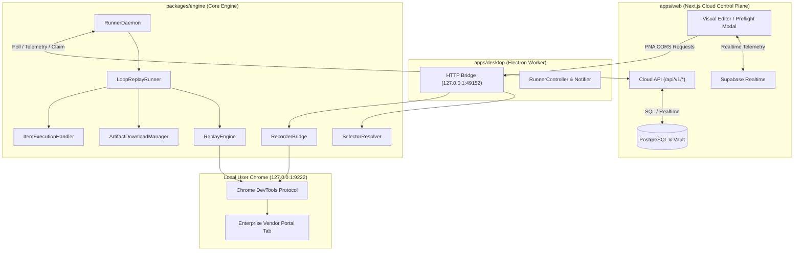
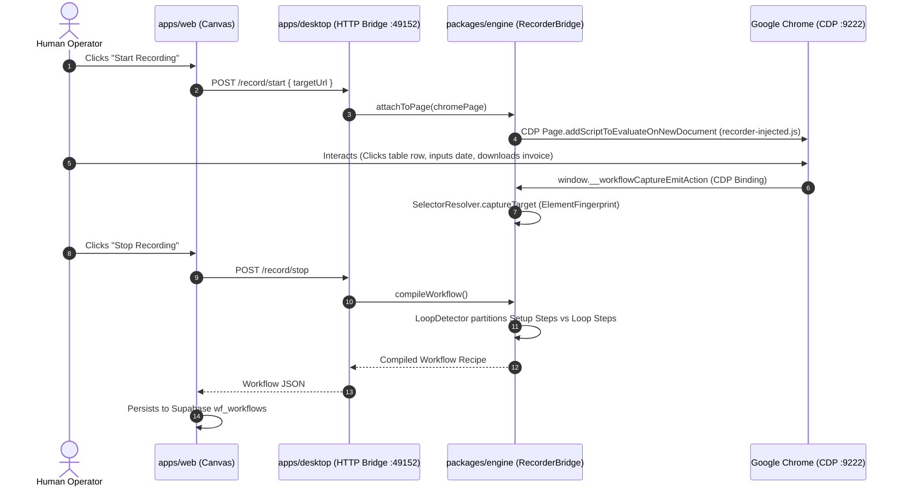
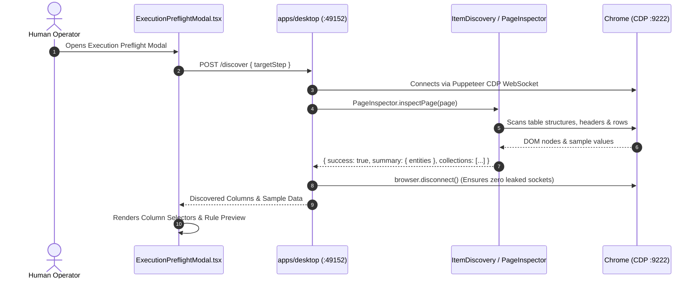
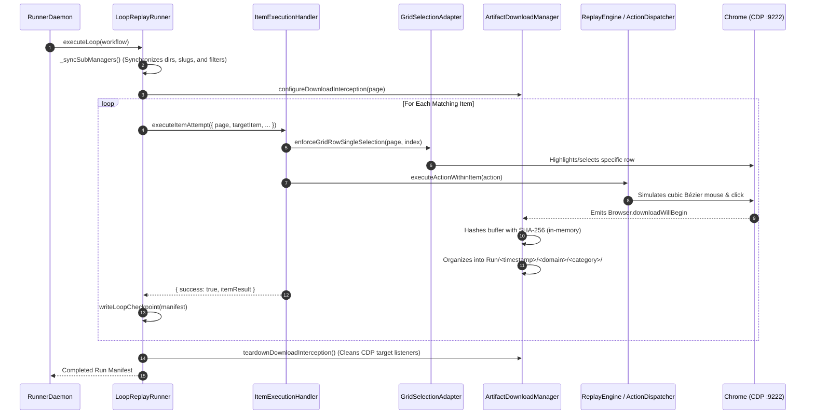
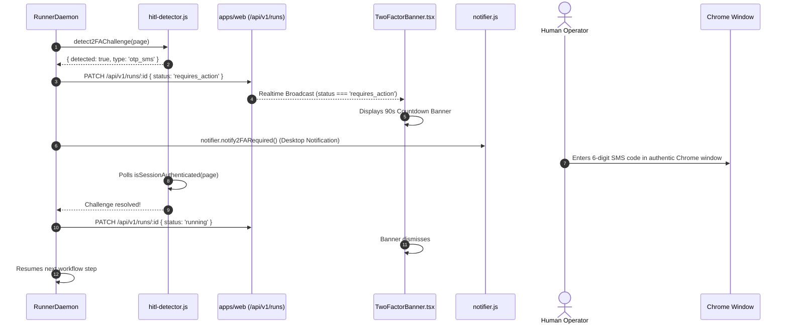
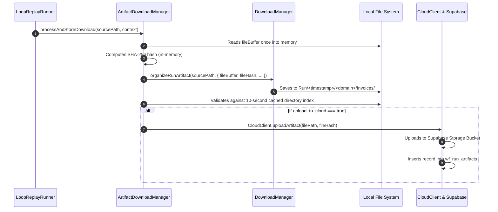

# ReFlow System Architecture & Technical Specifications

This document outlines the internal architecture, lifecycle state machines, data flow sequences, and security mechanisms of the **ReFlow** platform.

---

## 1. High-Level Architecture Overview

ReFlow operates across three cooperative tiers:
1. **Cloud Control Plane (`apps/web`)**: Next.js App Router providing the user dashboard, Drawflow node editor, live telemetry stream, and cloud artifacts vault.
2. **Desktop Worker & Bridge (`apps/desktop`)**: Electron background process exposing a localhost HTTP bridge on port `49152` and managing genuine local Chrome instances on CDP port `9222`.
3. **Core Automation Engine (`packages/engine`)**: Reusable Node.js engine for recording DevTools events, resolving selectors, generalizing loops, and executing self-healing replay runs.

---

## 2. End-to-End Lifecycle Data Flows

### Flow 1: Zero-Extension Recording & Generalization
Captures a single human demonstration and compiles it into an iterative workflow without third-party browser extensions.

---

### Flow 2: Live Preflight DOM Discovery
Inspects target portals at runtime before dispatching execution to preview table columns, calculate matching item counts, and configure relational filters.

---

### Flow 3: Autonomous Loop Replay & Sub-Manager Delegation
Executes iterative workflows using modular sub-classes coordinated by `LoopReplayRunner`.

---

### Flow 4: 90-Second Human-in-the-Loop (HITL) 2FA Recovery
Handles OTP, MFA, and CAPTCHA prompts without failing or aborting execution runs.

---

### Flow 5: Cryptographic Deduplication & Vault Storage
Prevents redundant downloads across runs and archives files securely.

---

## 3. Security & Reliability Architecture

### 3.1 Runner Authentication & Heartbeat Caching (`runner-auth.ts`)
* **Format**: Supports `Bearer ps_live_<16-char-prefix>` and session cookies.
* **In-Memory Caching (`orgPrefixCache`)**: Resolves prefix-to-UUID mappings with a 60-second in-memory cache, eliminating full-table scans of `wf_organizations` during 3-second runner polling loops.
* **Heartbeat Write Throttling (`lastHeartbeatWriteCache`)**: Telemetry updates to `wf_organizations` are throttled to execute only on dedicated runner registration calls or at most once every 15 seconds per organization.
* **Strict Tenant Isolation**: `?org_id=` query parameters provided by authenticated session users are verified against `wf_organization_members` with `.limit(20)` before allowing context override.

### 3.2 Private Network Access (PNA) CORS Hardening (`http-bridge.js`)
* Bridges browser contexts to local server `127.0.0.1:49152`.
* Rejects arbitrary origin reflection. Origins are strictly checked against:
  * `http://localhost:*` and `http://127.0.0.1:*`
  * `https://*.vercel.app`
  * `https://*.reflow.io`, `https://*.reflow.ai`, `https://*.reflow.app`, `https://*.reflow.dev`
  * Configured cloud dashboard URL from `configManager`.
* Unrecognized origins are restricted to `http://localhost:3000` with credential access disabled.

### 3.3 Server-Side Request Forgery (SSRF) Protection (`/api/v1/webhooks/test`)
* Blocks loopback destinations (`127.0.0.1`, `localhost`).
* Blocks link-local cloud metadata endpoints (`169.254.169.254`).
* Blocks private IPv4 ranges (`10.0.0.0/8`, `172.16.0.0/12`, `192.168.0.0/16`).
* Disables `x-test-bypass` headers in production environments (`process.env.NODE_ENV === 'production'`).

### 3.4 Cryptographic Secrets Vault (`/api/v1/secrets`)
* Encrypted at rest using **AES-256-GCM** with 96-bit random initialization vectors (IVs) and 128-bit authentication tags.
* Master encryption key managed via `VAULT_ENCRYPTION_KEY` environment variable.
